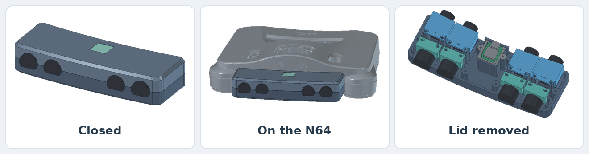

# NintendoSpy N64 reader — ESP32

## How it works

The adapter reads input from up to four Nintendo 64 (N64) controllers and shows their buttons and stick positions in a browser.
It connects between the console and controllers without changing their signals.
The console must run and poll the controllers for input to appear.

## Enclosure options

### Four-port enclosure

The verified v1.4 enclosure fits all four controller ports. The shell is 168.6 × 58.1 × 32.0 mm.



[Printing and assembly](cad/Enclosure/README.md) · [OrcaSlicer project](cad/Enclosure/Enclosure-full-enclosure-v1.4-Orca-complete.3mf)

### Two-port enclosure

The verified two-port enclosure fits the two left-hand ports and leaves ports 3 and 4 accessible. The shell is 75.5 × 58.1 × 28.2 mm. It uses two male plugs, two female sockets, three M2 closure screws and nuts, and eight keeper screws.


[Printing and assembly](cad/Enclosure/TwoPort/README.md) · [OrcaSlicer project](cad/Enclosure/TwoPort/Enclosure-two-port-Orca-complete.3mf)

## Parts list

For one complete four-controller adapter with the [verified v1.4 enclosure](cad/Enclosure/README.md):

| Quantity     | Part                                                            | Notes / source                                                                                                                                                                                          |
| ------------ | --------------------------------------------------------------- | ------------------------------------------------------------------------------------------------------------------------------------------------------------------------------------------------------- |
| 1            | ESP32-S3 Super Mini                                             | Brains!                                                                                                                                                                                                 |
| 4            | Standalone female N64 controller connectors                     | [Female connectors used for this build](https://www.aliexpress.com/item/1005008958336033.html).                                                                                                         |
| 4 male plugs | Male N64 connectors cut from donor cables                       | [Donor cables used for this build](https://www.aliexpress.com/item/1005008510879323.html). Cut off the male ends and remove their outer moulded housings; the enclosure holds the smaller inner bodies. |
| 1            | 100 µF electrolytic capacitor, rated at least 6.3 V             | Connected across the ESP32's 3V3 and GND, as shown below.                                                                                                                                               |
| 6            | M2 × 20 mm countersunk machine screws / bolts                   | Close the enclosure.                                                                                                                                                                                    |
| 6            | M2 nuts                                                         | Embedded in the upper shell during the print pause.                                                                                                                                                     |
| 18           | 2 mm nominal × 8 mm countersunk screws suitable for plastic     | Two for each of the eight connector keepers. And holding the ESP down                                                                                                                                   |
| 1 set        | Printed enclosure parts                                         | [Print-ready v1.4 3MF](cad/Enclosure/Enclosure-full-enclosure-v1.4-Orca-complete.3mf); the light window is optional.                                                                                    |

## Setup

### Wiring

> [!WARNING]
> **Do not connect USB-C while the adapter is connected to the N64 console.**
> Fully disconnect the adapter from **every console port it plugs into** before connecting USB-C to a computer or USB power source. Disconnect USB-C before reconnecting the adapter to the console.
>
> **Turning the console off is not enough.** USB power can backfeed the console’s 3.3V rail and potentially damage hardware. The 100 µF capacitor does not prevent backfeeding.


[Download the wiring diagram (SVG)](docs/n64-esp32-wiring.svg).
The diagram shows the component side of the Super Mini board, with USB at the top.
For the two-port adapter, wire ports 1 and 2 using the same pin assignments.

| Connection | ESP32 pin |
| ---------- | --------- |
| Port 1 DATA (middle pin) | GPIO 13 |
| Port 2 DATA (middle pin) | GPIO 12 |
| Port 3 DATA (middle pin) | GPIO 11 |
| Port 4 DATA (middle pin) | GPIO 10 |
| 3.3V from one console port | 3V3 |
| GND from the same console port | GND |

1. Connect the DATA lines as shown in the diagram and table.
2. Connect one console port's 3.3V and GND to the ESP32.
   Keep each controller's power and ground passthrough connections.
3. Connect a **100 µF electrolytic capacitor**, rated at least **6.3V**, across ESP32 3V3 and GND.
   Place it close to the board with short leads.
   Connect **positive (+) to 3V3**. Connect **negative (striped side) to GND**.
4. Leave the ESP32 **5V pin unconnected**.

### Install the firmware

Install PlatformIO, Node.js 22.12 or later, and npm on your computer.

**Before connecting USB-C, unplug the adapter completely from the console, even if the console is off.**

1. Connect the ESP32 to your computer through USB-C.
2. From the project directory, build and upload the firmware:

   ```sh
   pio run -t upload
   ```

3. Disconnect USB-C.
4. Connect the adapter to the console and controllers.
5. Turn on the console.

### Connect to WiFi

1. On first boot, join the open **`N64Spy-Setup`** WiFi network from a phone or laptop.
   The setup page opens automatically.
2. Select your WiFi network on the setup page.
3. Enter the network password.
4. Save the credentials.
   The adapter saves them and reconnects automatically on later boots.
5. Open [n64spy.local](http://n64spy.local/) in a browser to view controller input.

To change networks, hold **BOOT** for about **3 seconds** at startup or during normal operation.
The adapter deletes the saved network and restarts WiFi setup.
You can also use the controller input code below.

## LED sequences

| State | LED sequence |
| ----- | ------------ |
| Normal power | Solid red, unless disabled with the input code below. |
| WiFi setup waits for credentials | Red, 500 ms on / 500 ms off, repeating. |
| WiFi connects or reconnects | Blue, 500 ms on / 500 ms off, repeating. |
| WiFi connected | Two green flashes, 250 ms on / 250 ms off, then the normal power setting. |
| WiFi connection failed or lost | Three red flashes, 125 ms on / 125 ms off, then the connection or setup sequence. |
| Command mode | Solid green for up to 5 seconds. |
| Command accepted | Four magenta flashes, 125 ms on / 125 ms off, then the command takes effect. |

WiFi and command feedback still show when the normal red power LED is disabled.
Command feedback takes priority over WiFi status.

## Controller input codes

Commands are available after the initial WiFi setup completes, while the console runs and polls the controller.
These button presses also reach the game.

1. Push **L + R + D-pad down** together on any controller.
   The LED turns **green** for up to **5 seconds**.
2. Within that time, push one command button on the **same controller**.
   You can release the entry combination first.

| Button | Action |
| ------ | ------ |
| **START** | Delete saved WiFi credentials and reboot into **N64Spy-Setup**. |
| **Z** | Switch the normal red power LED on or off. The setting stays saved after a reboot. |

An accepted command ends command mode and shows the magenta confirmation sequence before it takes effect.
If you already held the command button when command mode started, release it before you push it again.
Other buttons and simultaneous **START + Z** presses do not select a command.

If five seconds pass without a command, the LED returns to its normal setting.
To enter command mode again, release **L + R + D-pad down**, then push the combination again.
