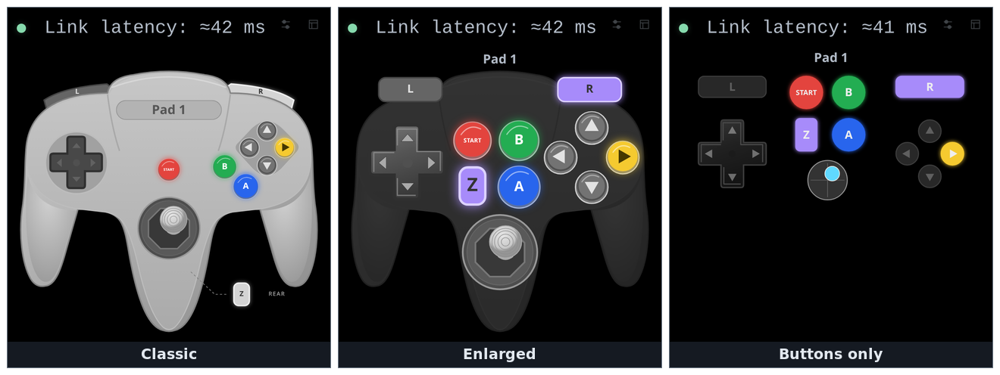
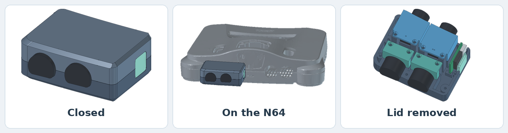
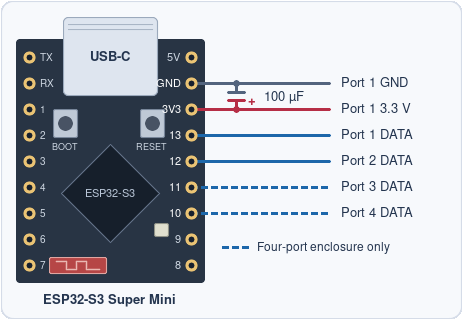

# NintendoSpy N64 reader — ESP32

This passthrough adapter shows button presses and stick positions from up to four Nintendo 64 controllers in a browser. Input appears when the console polls the controllers.

[](docs/input-viewer-themes.png)

## Enclosures

If you reslice either project, check that the nut-insertion pause comes before the pockets are covered.

### Four-port


[OrcaSlicer project](cad/Enclosure/Enclosure-full-enclosure-v1.4-Orca-complete.3mf)

1. Print the shells and keepers in PLA and the optional LED window in translucent PETG. Insert six M2 nuts into the upper shell at the pause on plate 1 (14.12 mm).
2. Seat the stripped male plugs flat side up. Fit male keepers 1–4 from left to right as viewed from the controller side, then install the female sockets and their keepers. Keep the keeper screw heads flush or recessed.
3. Check that the adapter seats evenly on the console without force. Follow the [wiring guide](#wiring) for all four ports.
4. Fit the ESP32 under its keeper with USB-C toward the console. Keep wires clear of the lid and screws. Fit the LED window if using it, then screw the lid closed.

### Two-port



[OrcaSlicer project](cad/Enclosure/TwoPort/Enclosure-two-port-Orca-complete.3mf)

1. Print the shells and keepers in PLA and the LED window in translucent PETG. Insert the three M2 nuts into the upper shell at the pause on plate 1 (13.16 mm).
2. Fit the connectors under their keepers and follow the [wiring guide](#wiring) for ports 1 and 2.
3. Slide the ESP32 into its guides with USB-C toward the console and the components facing the LED window. Slide the window into its slot and screw the lid closed. Remove the lid to access BOOT.

## Parts list

| Four-port | Two-port | Part |
| :-------: | :------: | ---- |
| 1 | 1 | ESP32-S3 Super Mini |
| 4 | 2 | [Female N64 controller sockets](https://www.aliexpress.com/item/1005008958336033.html) |
| 4 | 2 | Male N64 plugs from [donor cables](https://www.aliexpress.com/item/1005008510879323.html), with the outer moulding removed |
| 1 | 1 | 100 µF electrolytic capacitor rated 6.3 V or higher |
| 6 | 3 | M2 × 20 mm countersunk machine screws |
| 6 | 3 | M2 nuts |
| 16 | 8 | 2 × 8 mm countersunk screws for plastic (port keepers) |
| 2 | — | M2 × 8 mm screws for plastic (board keeper) |
| 1 set | 1 set | Printed enclosure parts |

## Setup

### Wiring

> [!WARNING]
> **Unplug the adapter from every console port before connecting USB-C, even if the console is off.** USB power can backfeed the console and damage it. Unplug USB-C before reconnecting the adapter to the console.

[](docs/n64-esp32-wiring.svg)

1. Wire each console port straight through to its controller socket (3.3 V, DATA, GND).
2. Tap each DATA line (middle pin) as shown.
3. Power the ESP32 from port 1's 3.3 V and GND. Leave the ESP32's 5V pin open.
4. Fit the capacitor close to the ESP32 with short leads, positive to 3V3 and negative (striped) to GND.

### Install the firmware

Install PlatformIO, Node.js 22.12 or later, and npm.

1. With the adapter unplugged from the N64, connect the ESP32 to your computer via USB-C.
2. Run this from the project directory.

   ```sh
   pio run -t upload
   ```

3. Unplug USB-C, connect the adapter and controllers, and turn on the console.

### Connect to WiFi

1. On first boot, join **N64Spy-Setup**.
2. On the setup page, select your network, enter its password, and save.
3. Open [n64spy.local](http://n64spy.local/) to view controller input.

To reset WiFi setup, hold **BOOT** for 3 seconds or use the controller command below.

## LED sequences

| State | LED |
| ----- | --- |
| Power | Solid red, if enabled |
| WiFi setup | Slow red blink |
| WiFi connecting | Slow blue blink |
| WiFi connected | Two green flashes |
| WiFi failed or disconnected | Three red flashes |
| Command mode | Solid green for up to 5 seconds |
| Command accepted | Four magenta flashes |

WiFi and command feedback still appear with the power LED disabled.

## Controller input codes

After WiFi setup, press **L + R + D-pad down** together in a running game. While the LED is green, press **START** or **Z** on the same controller. The game also receives these inputs.

| Button | Action |
| ------ | ------ |
| **START** | Forget the saved network and restart WiFi setup |
| **Z** | Toggle the red power LED and save the setting |
